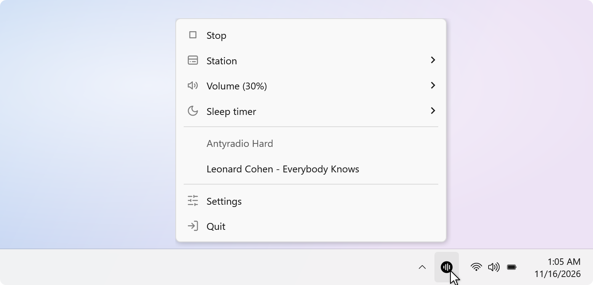
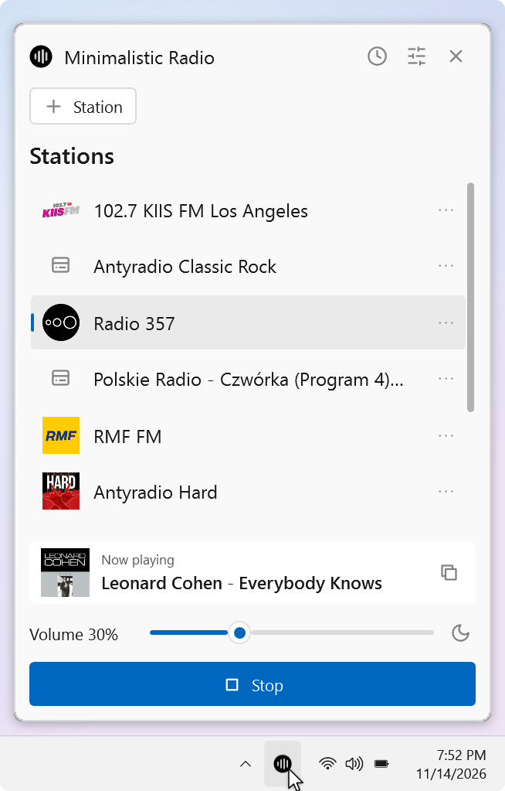
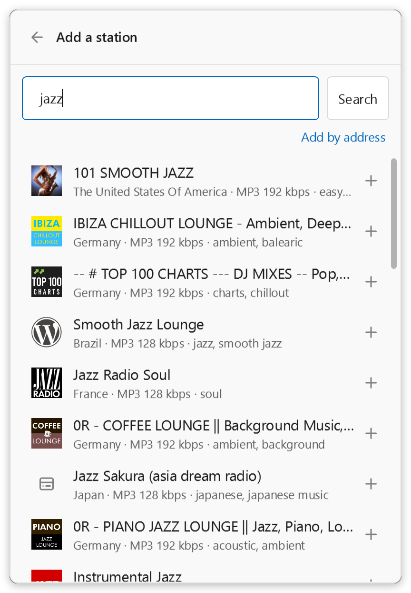
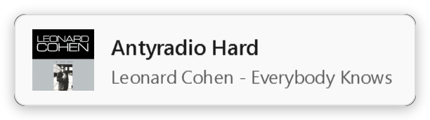

<h1 align="center">Minimalistic Radio - only 219 KB</h1>

A tiny open-source internet radio for Windows 10 and 11 that lives next to the clock. One <code>.exe</code>, no installer, nothing else to install.

  

Not signed yet: if Windows SmartScreen asks, choose <i>More info</i> → <i>Run anyway</i>.

<table align="center">
  <tr>
    <td align="center" valign="top">
      <a href="docs/screenshots/README.md#right-click-the-menu"><picture>
        <source media="(prefers-color-scheme: dark)" srcset="docs/screenshots/tray-menu-dark.png">
        
      </picture></a>
       <b>Right click</b> on the icon: the menu
    </td>
    <td align="center" valign="top">
      <a href="docs/screenshots/README.md#left-click-the-player"><picture>
        <source media="(prefers-color-scheme: dark)" srcset="docs/screenshots/tray-panel-dark.png">
        
      </picture></a>
       <b>Left click</b>: the player
    </td>
  </tr>
</table>

<table align="center">
  <tr>
    <td align="center" valign="top">
      <a href="docs/screenshots/README.md#station-search"><picture>
        <source media="(prefers-color-scheme: dark)" srcset="docs/screenshots/search-dark.png">
        
      </picture></a>
       Station search: thousands of stations from radio-browser.info
    </td>
    <td align="center" valign="top">
      <a href="docs/screenshots/README.md#song-history"><picture>
        <source media="(prefers-color-scheme: dark)" srcset="docs/screenshots/history-dark.png">
        
      </picture></a>
       Song history
    </td>
  </tr>
  <tr>
    <td align="center" valign="top">
      <a href="docs/screenshots/README.md#settings"><picture>
        <source media="(prefers-color-scheme: dark)" srcset="docs/screenshots/settings-dark.png">
        
      </picture></a>
       Settings
    </td>
    <td align="center" valign="middle">
      <a href="docs/screenshots/README.md#station-change-card"><picture>
        <source media="(prefers-color-scheme: dark)" srcset="docs/screenshots/card-dark.png">
        
      </picture></a>
       Station change card (media keys)
    </td>
  </tr>
</table>

## Languages

English, Polish, German, Ukrainian, Czech, Spanish, French, Italian and Portuguese (Settings → Language). Native speakers: if a translation sounds wrong, please fix it in [`src/Lang/*.po`](src/Lang) and send a pull request.

Some stations are never shown in search or suggestions; the list is in [`data/banned-stations.json`](data/banned-stations.json).

## Privacy

The radio collects no personal data: no accounts, no telemetry, no ads. It only connects to:
- the servers of the stations you listen to,
- the websites the station logos come from, for your list and for search results,
- `radio-browser.info`: when you open the station search or search for stations, it gets your country code and what you typed,
- `itunes.apple.com`: the artist and title of the song that's playing, to find its cover art ([Apple's privacy policy](https://www.apple.com/legal/privacy/)),
- `api.github.com`: to check for updates, every few hours; can be turned off in Settings → Updates ([GitHub's privacy statement](https://docs.github.com/site-policy/privacy-policies/github-general-privacy-statement)),
- `github.com`: to download a new version, only when there is one,
- `stream.radio357.pl`: song titles, only while Radio 357 is playing.

Nothing else is sent. Like any internet connection, these servers see your IP address.

Settings, the station list and the history are stored in `%LOCALAPPDATA%\Minimalistic Radio`.

## Uninstall

There's no installer. The radio adds a Start menu shortcut, so Windows shows its name and icon in the media controls, and an entry in Startup apps only if you turn on *Start with Windows*. To remove everything:

1. Settings → turn off *Start with Windows*, then *Quit*.
2. Delete `Minimalistic-Radio.exe`, the folder `%LOCALAPPDATA%\Minimalistic Radio` and the shortcut `%APPDATA%\Microsoft\Windows\Start Menu\Programs\Minimalistic Radio.lnk`.

## License

[MIT](LICENSE). Icons: [Lucide](https://lucide.dev) (ISC). Building from source: [docs/BUILDING.md](docs/BUILDING.md).
