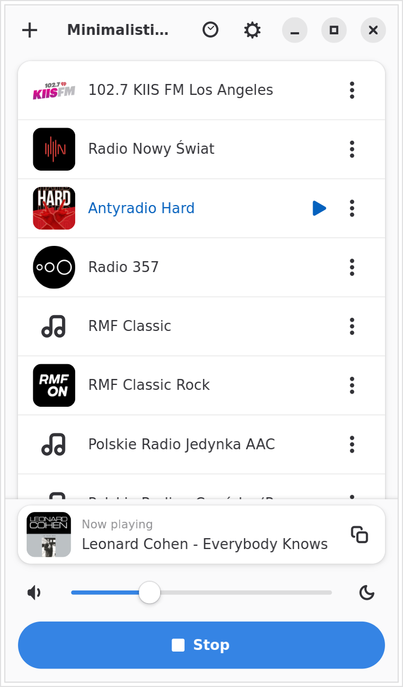
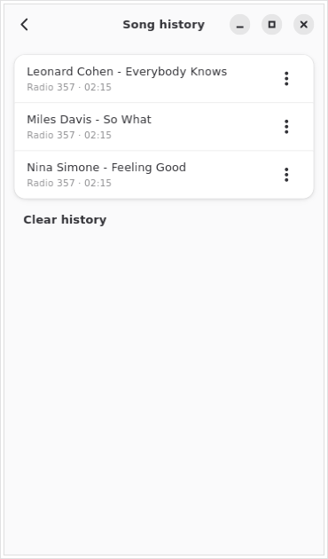
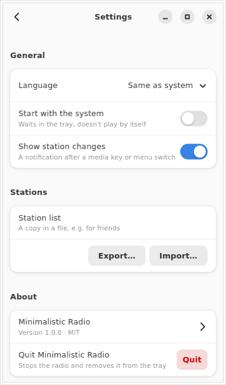
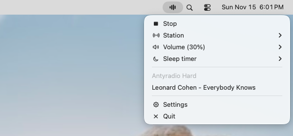
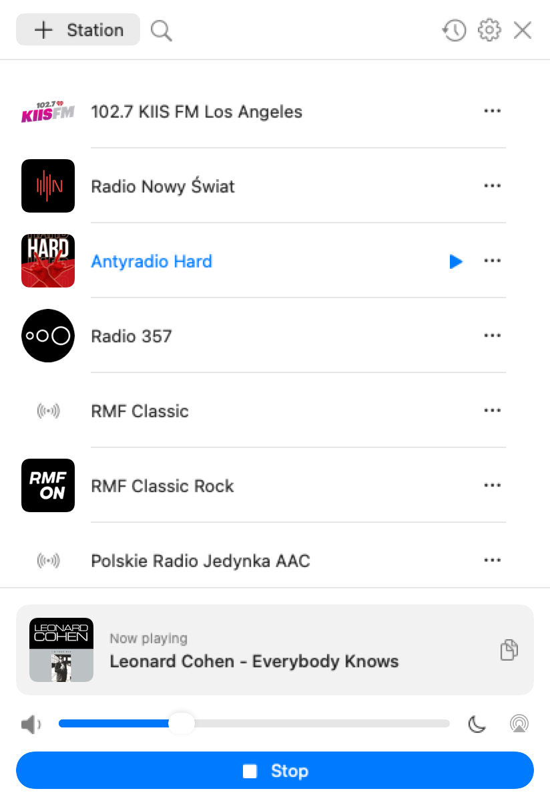
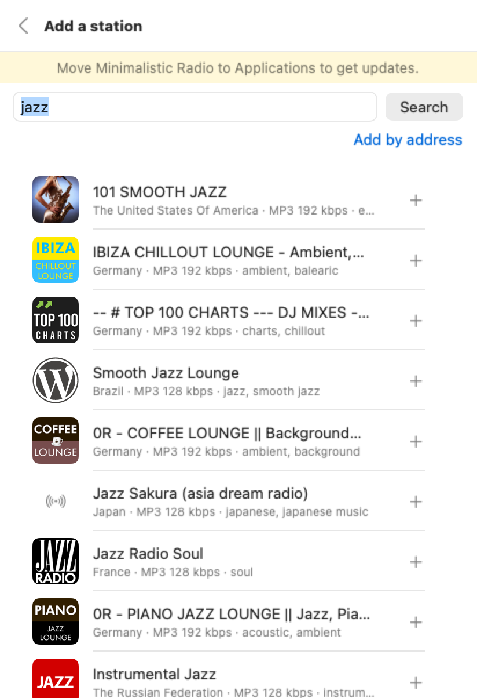
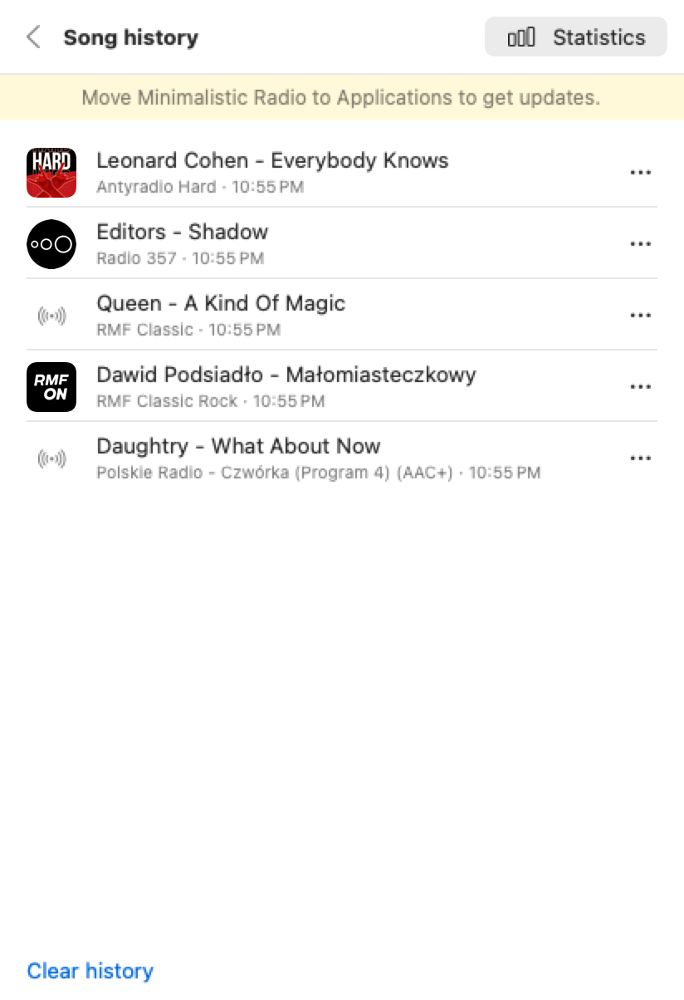
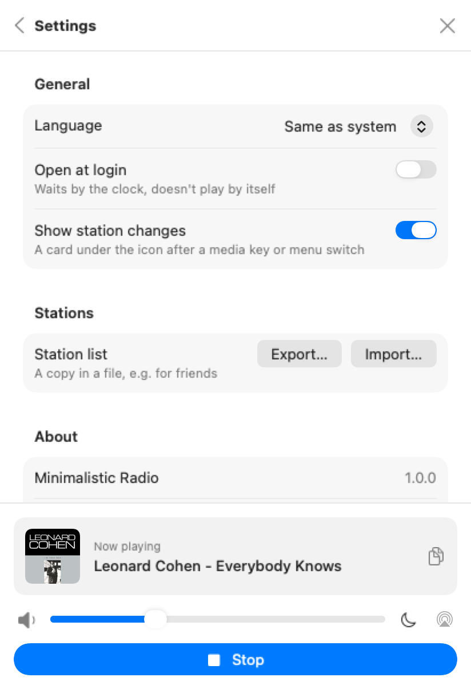

<p align="center"></p>

<h1 align="center">Minimalistic Radio - only 219 KB</h1>

<p align="center">A tiny open-source internet radio for Windows 10 and 11 that lives next to the clock.<br>One <code>.exe</code>, no installer, nothing else to install. Also for <a href="#linux">Linux</a> and <a href="#macos">macOS</a>.</p>

<p align="center">
  <a href="https://github.com/zal3wa/minimalistic-radio/releases/latest/download/Minimalistic-Radio.exe"></a>
  <a href="https://zal3wa.github.io/minimalistic-radio/minimalistic-radio.flatpakref"></a>
  <a href="https://github.com/zal3wa/minimalistic-radio/releases/download/macos-download/Minimalistic-Radio.dmg"></a>
</p>

<p align="center"><sub>Windows: not signed yet, so if SmartScreen asks, choose <i>More info</i> → <i>Run anyway</i>.<br>Linux: the file opens in GNOME Software or Discover, and the radio then updates itself. On Ubuntu, <a href="#linux">enable Flatpak first</a>.<br>macOS: not from Apple's store, so the first time choose <a href="#macos"><i>Open Anyway</i></a> in System Settings → Privacy &amp; Security.</sub></p>

<table align="center">
  <tr>
    <td align="center" valign="top">
      <a href="docs/screenshots/README.md#right-click-the-menu"><picture>
        <source media="(prefers-color-scheme: dark)" srcset="docs/screenshots/tray-menu-dark.png">
        
      </picture></a>
      <br><b>Right click</b> on the icon: the menu
    </td>
  </tr>
</table>

<table align="center">
  <tr>
    <td align="center" valign="top" width="50%">
      <a href="docs/screenshots/README.md#left-click-the-player"><picture>
        <source media="(prefers-color-scheme: dark)" srcset="docs/screenshots/stations-dark.png">
        
      </picture></a>
      <br><b>Left click</b>: the player
    </td>
    <td align="center" valign="top" width="50%">
      <a href="docs/screenshots/README.md#station-search"><picture>
        <source media="(prefers-color-scheme: dark)" srcset="docs/screenshots/search-dark.png">
        
      </picture></a>
      <br>Station search: thousands of stations from radio-browser.info
    </td>
  </tr>
  <tr>
    <td align="center" valign="top" width="50%">
      <a href="docs/screenshots/README.md#song-history"><picture>
        <source media="(prefers-color-scheme: dark)" srcset="docs/screenshots/history-dark.png">
        
      </picture></a>
      <br>Song history
    </td>
    <td align="center" valign="top" width="50%">
      <a href="docs/screenshots/README.md#settings"><picture>
        <source media="(prefers-color-scheme: dark)" srcset="docs/screenshots/settings-dark.png">
        
      </picture></a>
      <br>Settings
    </td>
  </tr>
</table>

## Linux

The same radio for Linux, made with GTK and libadwaita: a tray icon (where the desktop has one), media keys, the sleep timer, station search, song history and the Windows station list (export it there, import it here). It runs as a Flatpak or a Snap.

<p align="center"><a href="https://zal3wa.github.io/minimalistic-radio/minimalistic-radio.flatpakref"></a></p>

<table align="center">
  <tr>
    <td align="center" valign="top">
      <a href="docs/screenshots/README.md#linux-the-tray-menu-on-ubuntu"><picture>
        <source media="(prefers-color-scheme: dark)" srcset="docs/screenshots/linux-tray-menu-dark.png">
        
      </picture></a>
      <br>The tray menu on Ubuntu
    </td>
  </tr>
</table>

<!-- When Flathub is live, remove these comment marks:
<a href="https://flathub.org/apps/io.github.zal3wa.minimalistic-radio"></a>
-->
<!-- When the Snap Store page is live, remove these comment marks:
<a href="https://snapcraft.io/minimalistic-radio"></a>
-->

**Install:** open [minimalistic-radio.flatpakref](https://zal3wa.github.io/minimalistic-radio/minimalistic-radio.flatpakref). It opens in GNOME Software or Discover: one click on Install. Or in a terminal:

```
flatpak install https://zal3wa.github.io/minimalistic-radio/minimalistic-radio.flatpakref
```

Updates are automatic: they come through GNOME Software or Discover (or `flatpak update`), and the radio shows a green arrow when a new version is ready. On Ubuntu, [enable Flatpak](https://flathub.org/setup/Ubuntu) first; the Snap Store comes later. The `.snap` on the [releases page](https://github.com/zal3wa/minimalistic-radio/releases) is for testing only and does not update.

The app is under 1 MB. The GNOME platform it runs on is installed once and shared with other apps. The Flatpak plays more formats (it has FFmpeg). The Snap plays MP3, AAC and HE-AAC, Ogg/Opus and FLAC, including HLS streams; rare formats such as WMA play only in the Flatpak.

Linux beta testers are welcome: see the [test checklist](docs/LINUX-TEST-CHECKLIST.md).

<table align="center">
  <tr>
    <td align="center" valign="top" width="50%">
      <a href="docs/screenshots/README.md#linux-stations"><picture>
        <source media="(prefers-color-scheme: dark)" srcset="docs/screenshots/linux-stations-dark.png">
        
      </picture></a>
      <br>Stations
    </td>
    <td align="center" valign="top" width="50%">
      <a href="docs/screenshots/README.md#linux-station-search"><picture>
        <source media="(prefers-color-scheme: dark)" srcset="docs/screenshots/linux-search-dark.png">
        
      </picture></a>
      <br>Station search
    </td>
  </tr>
  <tr>
    <td align="center" valign="top" width="50%">
      <a href="docs/screenshots/README.md#linux-song-history"><picture>
        <source media="(prefers-color-scheme: dark)" srcset="docs/screenshots/linux-history-dark.png">
        
      </picture></a>
      <br>Song history
    </td>
    <td align="center" valign="top" width="50%">
      <a href="docs/screenshots/README.md#linux-settings"><picture>
        <source media="(prefers-color-scheme: dark)" srcset="docs/screenshots/linux-settings-dark.png">
        
      </picture></a>
      <br>Settings
    </td>
  </tr>
</table>

## macOS

The same radio for the Mac, in the menu bar next to the clock: a click opens the player, a right click the menu. Control Center's Now Playing, the media keys and AirPods, the sleep timer, station search, song history, AirPlay to HomePods and other speakers, and actions for the Shortcuts app and Siri ("Play Minimalistic Radio"). The Windows and Linux station list moves over with Export and Import. For macOS 13 Ventura or newer, on Apple Silicon and Intel.

<p align="center"><a href="https://github.com/zal3wa/minimalistic-radio/releases/download/macos-download/Minimalistic-Radio.dmg"></a></p>

<table align="center">
  <tr>
    <td align="center" valign="top">
      <a href="docs/screenshots/README.md#macos-right-click-the-menu"><picture>
        <source media="(prefers-color-scheme: dark)" srcset="docs/screenshots/macos-menu-dark.png">
        
      </picture></a>
      <br><b>Right click</b> on the icon: the menu
    </td>
  </tr>
</table>

**Install:** open `Minimalistic-Radio.dmg` and drag Minimalistic Radio to Applications. The radio isn't from Apple's store, so the first time you open it macOS blocks it: click Done, open **System Settings → Privacy & Security**, scroll to "Minimalistic Radio was blocked", click **Open Anyway** and confirm with your password. That's needed once: updates come by themselves, with the green arrow, as on Windows.

The app is about 2 MB. Mac beta testers are welcome: see the [test checklist](docs/MACOS-TEST-CHECKLIST.md).

<table align="center">
  <tr>
    <td align="center" valign="top" width="50%">
      <a href="docs/screenshots/README.md#macos-click-on-the-icon-the-player"><picture>
        <source media="(prefers-color-scheme: dark)" srcset="docs/screenshots/macos-stations-dark.png">
        
      </picture></a>
      <br>Click on the icon: the player
    </td>
    <td align="center" valign="top" width="50%">
      <a href="docs/screenshots/README.md#macos-station-search"><picture>
        <source media="(prefers-color-scheme: dark)" srcset="docs/screenshots/macos-search-dark.png">
        
      </picture></a>
      <br>Station search
    </td>
  </tr>
  <tr>
    <td align="center" valign="top" width="50%">
      <a href="docs/screenshots/README.md#macos-song-history"><picture>
        <source media="(prefers-color-scheme: dark)" srcset="docs/screenshots/macos-history-dark.png">
        
      </picture></a>
      <br>Song history
    </td>
    <td align="center" valign="top" width="50%">
      <a href="docs/screenshots/README.md#macos-settings"><picture>
        <source media="(prefers-color-scheme: dark)" srcset="docs/screenshots/macos-settings-dark.png">
        
      </picture></a>
      <br>Settings
    </td>
  </tr>
</table>

## Languages

English, Polish, German, Ukrainian, Czech, Spanish, French, Italian and Portuguese (Settings → Language). Native speakers: if a translation sounds wrong, please fix it in [`src/Lang/*.po`](src/Lang) (Windows), [`linux/po/*.po`](linux/po) (Linux) or [`macos/Lang/*.po`](macos/Lang) (macOS) and send a pull request.

Some stations are never shown in search or suggestions; the list is in [`data/banned-stations.json`](data/banned-stations.json).

## Privacy

The radio collects no personal data: no accounts, no telemetry, no ads. It only connects to:
- the servers of the stations you listen to,
- the websites the station logos come from, for your list and for search results,
- `radio-browser.info`: when you open the station search or search for stations, it gets your country code and what you typed,
- `itunes.apple.com`: the artist and title of the song that's playing, to find its cover art ([Apple's privacy policy](https://www.apple.com/legal/privacy/)),
- `api.github.com`: to check for updates, every few hours; can be turned off in Settings → Updates ([GitHub's privacy statement](https://docs.github.com/site-policy/privacy-policies/github-general-privacy-statement)),
- `github.com`: to download a new version, only when there is one,
- `stream.radio357.pl`: song titles, only while Radio 357 is playing.

Nothing else is sent. Like any internet connection, these servers see your IP address.

The Linux version contacts the same servers, except GitHub: the radio itself never checks for updates. Flatpak and your software center get them from the radio's Flatpak repository at `zal3wa.github.io` (hosted by GitHub Pages), or from the Snap Store (the Flatpak also shows an update arrow, asked of Flatpak itself).

The macOS version contacts the same servers as the Windows one, the update check included (Settings → Updates). When you use Siri, Apple processes what you say, as for any app.

Settings, the station list and the history are stored in `%LOCALAPPDATA%\Minimalistic Radio` on Windows, in your user folders on Linux (inside the app's own folder for a Flatpak or a Snap), and in `~/Library/Application Support/Minimalistic Radio` on macOS.

## Uninstall

**Windows.** 
There's no installer. The radio adds a Start menu shortcut, so Windows shows its name and icon in the media controls, and an entry in Startup apps only if you turn on *Start with Windows*. To remove everything:

1. Settings → turn off *Start with Windows*, then *Quit*.
2. Delete `Minimalistic-Radio.exe`, the folder `%LOCALAPPDATA%\Minimalistic Radio` and the shortcut `%APPDATA%\Microsoft\Windows\Start Menu\Programs\Minimalistic Radio.lnk`.

**Linux.** Remove it in GNOME Software, Discover or App Center. The Flatpak asks whether to delete its data too (settings, station list, history); tick it to remove everything. To remove the radio's Flatpak repository as well, run `flatpak remote-delete minimalistic-radio`.

**macOS.** Settings → turn off *Open at login*, then *Quit Minimalistic Radio*. Drag Minimalistic Radio from Applications to the Bin, and delete the folders `~/Library/Application Support/Minimalistic Radio` and `~/Library/Caches/io.github.zal3wa.minimalistic-radio`.

## License

[MIT](LICENSE). Icons: [Lucide](https://lucide.dev) (ISC). Building from source: [docs/BUILDING.md](docs/BUILDING.md).
