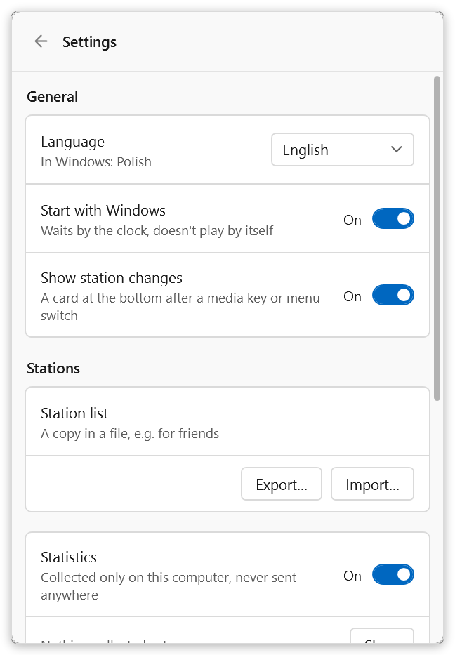

<p align="center"></p>

# Minimalistic Radio — only 191 KB

A tiny internet radio for Windows 10 and 11 that lives next to the clock. One `.exe`, no installer, nothing else to install.

<p align="center">
  <picture>
    <source media="(prefers-color-scheme: dark)" srcset="docs/screenshots/stations-dark.png">
    
  </picture>
</p>

<table>
  <tr>
    <td align="center">
      <picture>
        <source media="(prefers-color-scheme: dark)" srcset="docs/screenshots/history-dark.png">
        
      </picture>
      <br>Song history
    </td>
    <td align="center">
      <picture>
        <source media="(prefers-color-scheme: dark)" srcset="docs/screenshots/settings-dark.png">
        
      </picture>
      <br>Settings
    </td>
    <td align="center">
      <picture>
        <source media="(prefers-color-scheme: dark)" srcset="docs/screenshots/menu-dark.png">
        
      </picture>
      <br>Tray menu
    </td>
  </tr>
</table>

## Features

- **Next to the clock**: a click opens the panel in the corner of the screen, like the Windows 11 flyouts; right-click for a quick menu.
- **Your stations** with their logos. Search the [radio-browser.info](https://www.radio-browser.info) directory or add a stream by its address; reorder the list, export it and import someone else's (duplicates are skipped).
- **Win+A, media keys and the lock screen** show the song title, the artist and the cover art (or the station logo); previous/next switches stations.
- **Song history** with copy and search on Spotify or YouTube.
- **Sleep timer** (15–90 min) with a gentle fade-out.
- **Reconnects by itself** after the internet drops and after the computer wakes up.
- **Start with Windows** (optional), **English and Polish** (follows Windows or your choice), light and dark theme.
- **Updates like Discord**: every few hours the radio quietly downloads a new version; a green arrow then shows *Update Ready!* and one click restarts into it. No pop-ups.

## Download

Get the latest version from **[Releases → Minimalistic-Radio.exe](https://github.com/zal3wa/minimalistic-radio/releases/latest)** and run it.
The file isn't digitally signed, so Windows SmartScreen may ask first: *More info → Run anyway*.

## How it works

- The UI is WPF on **.NET Framework 4.8**, which is part of every Windows 10 and 11 — that's why the file is so small.
- MP3 and AAC (including HE-AAC/AAC+) are decoded by **Windows itself** (Media Foundation). For other formats (Ogg/Opus, FLAC, HLS) the radio downloads [FFmpeg](https://ffmpeg.org) once (a [gyan.dev](https://www.gyan.dev/ffmpeg/builds/) build, checked against its SHA-256). The settings let you choose: automatic, Windows only, or always FFmpeg.
- A player on the Windows 11 taskbar is possible with the free [Windhawk](https://windhawk.net) and its [Taskbar Fluent Media Player](https://windhawk.net/mods/taskbar-fluent-media-player) mod — the radio's settings walk you through it. The radio itself doesn't modify Windows.

## Privacy

The radio collects no data. It only connects to:
- the servers of the stations you listen to,
- `radio-browser.info` — when you search for stations,
- `itunes.apple.com` — to find the cover art of the song that's playing, by artist and title,
- `api.github.com` — to check for updates (every few hours, can be turned off),
- `github.com` — to download FFmpeg or a new version, only when needed,
- `stream.radio357.pl` — song titles of Radio 357.

Settings, the station list and the history are stored in `%LOCALAPPDATA%\Minimalistic Radio`.

## Building

You need the [.NET SDK](https://dotnet.microsoft.com/download) 8 or newer and the Windows 10/11 SDK (from the Visual Studio Installer or [standalone](https://developer.microsoft.com/windows/downloads/windows-sdk/)).

```
dotnet build src/MinimalisticRadio.csproj -c Release -o out
```

`out\Minimalistic Radio.exe --test-menu` runs the self-test (exit code 0 means OK), and `--test-menu --screenshot` renders the screenshots for this page into `%TEMP%\MinimalisticRadio-shot-*.png`.
Pushing a `v*` tag builds and publishes a release with GitHub Actions; the release notes come from the annotated tag's message.

## Project structure

```
src/
  Program.cs     startup, single instance
  Radio/         tray icon, menu and playback (RadioApp), the panel (RadioPanel)
  Audio/         station connection, decoding by Windows, FFmpeg fallback
  Services/      cover art, updates, storage, Windows integration, language
  Theme/         colours and Windows 11 style controls
  Assets/        app icon (radio.ico) and the Lucide icons' licence
docs/            icon.svg (the icon's source), README screenshots
tools/IconMaker  draws radio.ico in all sizes: dotnet run --project tools/IconMaker -- <folder>
```

## License

[MIT](LICENSE). Icons: [Lucide](https://lucide.dev) (ISC, see `src/Assets/Lucide_Icons_license.txt`).
