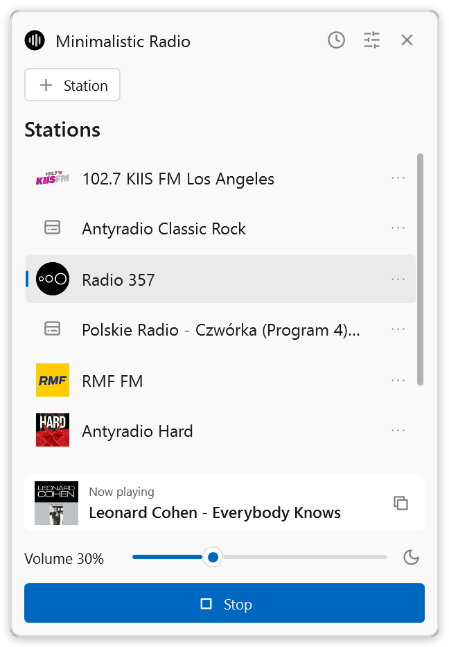
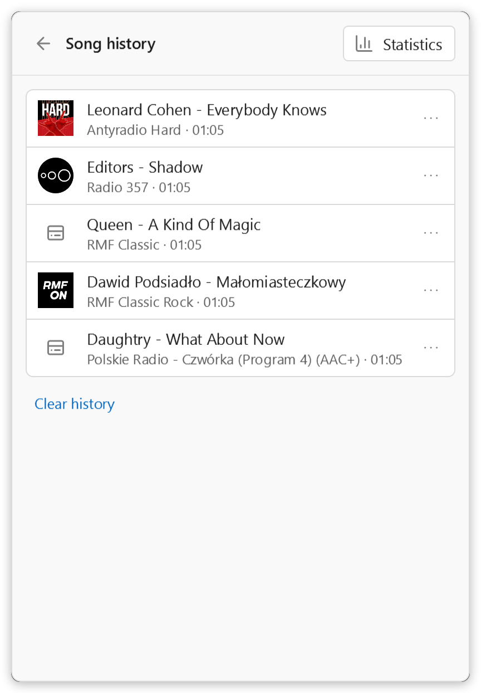
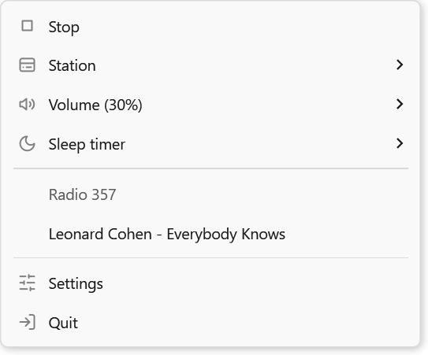

<h1 align="center">Minimalistic Radio - only 197 KB</h1>

A tiny internet radio for Windows 10 and 11 that lives next to the clock. One <code>.exe</code>, no installer, nothing else to install.

  

Not signed yet: if Windows SmartScreen asks, choose <i>More info</i> → <i>Run anyway</i>.

<table align="center">
  <tr>
    <td align="center" valign="top">
      <picture>
        <source media="(prefers-color-scheme: dark)" srcset="docs/screenshots/stations-dark.png">
        
      </picture>
       Stations and now playing
    </td>
    <td align="center" valign="top">
      <picture>
        <source media="(prefers-color-scheme: dark)" srcset="docs/screenshots/history-dark.png">
        
      </picture>
       Song history
    </td>
  </tr>
  <tr>
    <td align="center" valign="top">
      <picture>
        <source media="(prefers-color-scheme: dark)" srcset="docs/screenshots/settings-dark.png">
        
      </picture>
       Settings
    </td>
    <td align="center" valign="top">
      <picture>
        <source media="(prefers-color-scheme: dark)" srcset="docs/screenshots/menu-dark.png">
        
      </picture>
       Tray menu
    </td>
  </tr>
</table>

## Privacy

The radio collects no data. It only connects to:
- the servers of the stations you listen to,
- `radio-browser.info`: when you search for stations,
- `itunes.apple.com`: to find the cover art of the song that's playing, by artist and title,
- `api.github.com`: to check for updates (every few hours, can be turned off),
- `github.com`: to download FFmpeg or a new version, only when needed,
- `stream.radio357.pl`: song titles of Radio 357.

Settings, the station list and the history are stored in `%LOCALAPPDATA%\Minimalistic Radio`.

## License

[MIT](LICENSE). Icons: [Lucide](https://lucide.dev) (ISC). Building from source: [docs/BUILDING.md](docs/BUILDING.md).
