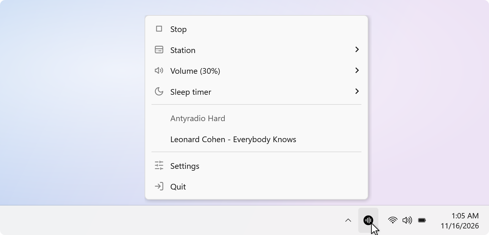
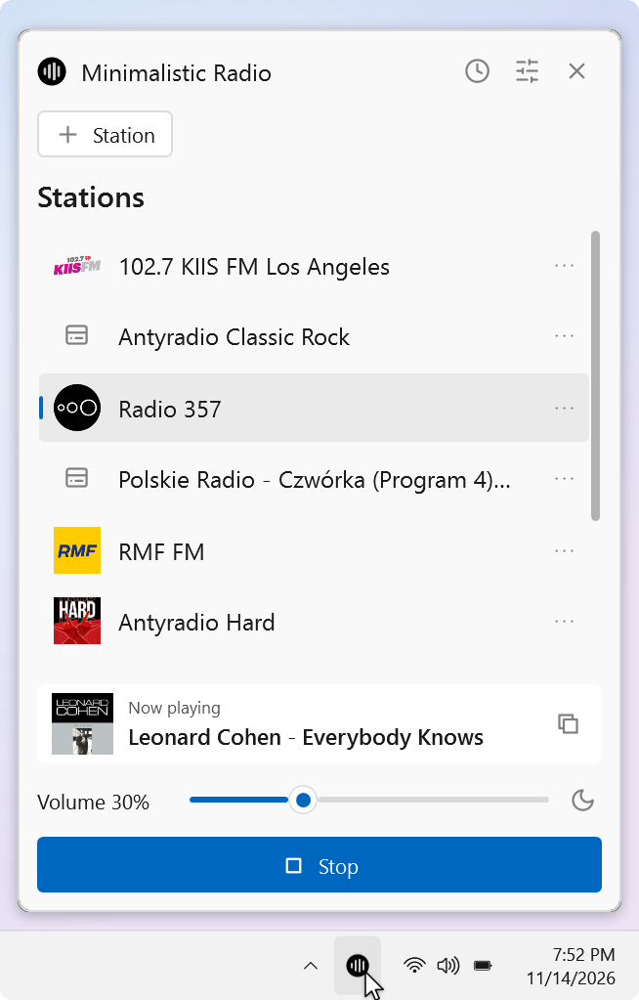
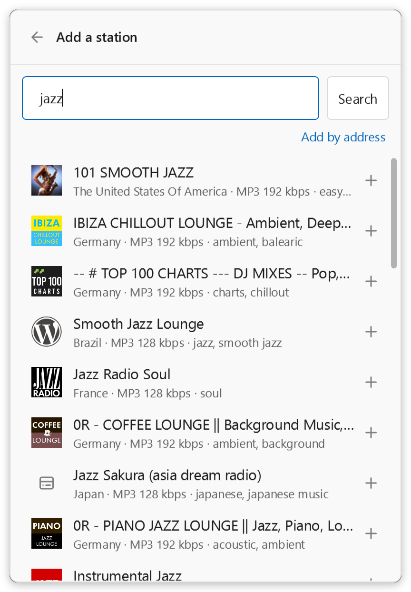
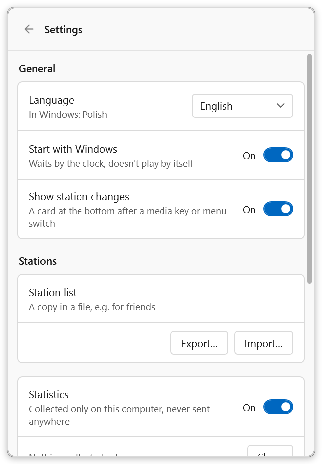
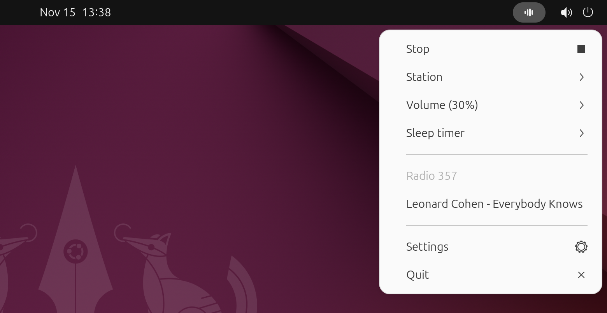
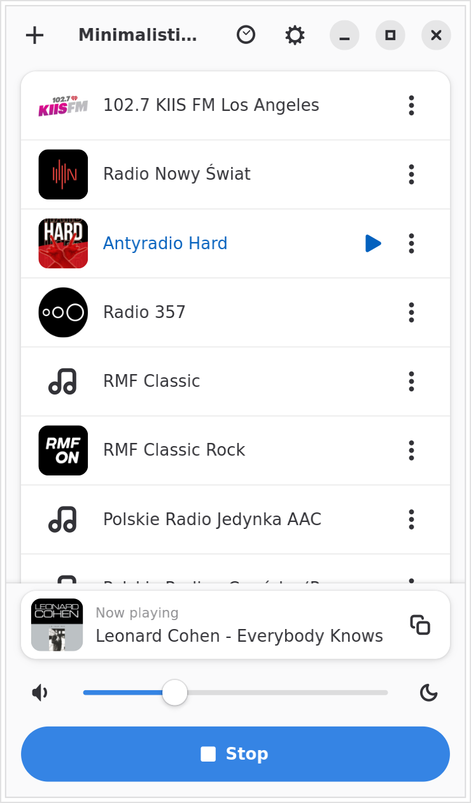
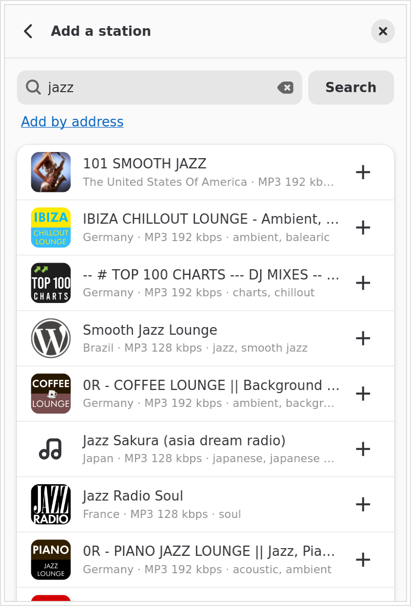
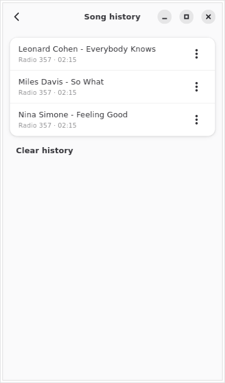
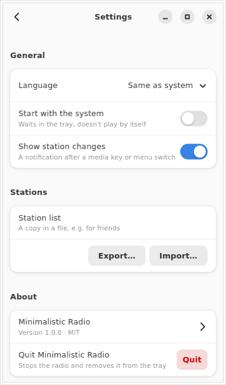

# Screenshots

Full-size pictures of Minimalistic Radio. [Back to the README](../../README.md)

## Right click: the menu

<picture>
  <source media="(prefers-color-scheme: dark)" srcset="tray-menu-dark.png">
  
</picture>

## Left click: the player

<picture>
  <source media="(prefers-color-scheme: dark)" srcset="tray-panel-dark.png">
  
</picture>

## Station search

<picture>
  <source media="(prefers-color-scheme: dark)" srcset="search-dark.png">
  
</picture>

## Song history

<picture>
  <source media="(prefers-color-scheme: dark)" srcset="history-dark.png">
  
</picture>

## Settings

<picture>
  <source media="(prefers-color-scheme: dark)" srcset="settings-dark.png">
  
</picture>

## Station change card

<picture>
  <source media="(prefers-color-scheme: dark)" srcset="card-dark.png">
  
</picture>

## Linux: the tray menu on Ubuntu

<picture>
  <source media="(prefers-color-scheme: dark)" srcset="linux-tray-menu-dark.png">
  
</picture>

## Linux: stations

<picture>
  <source media="(prefers-color-scheme: dark)" srcset="linux-stations-dark.png">
  
</picture>

## Linux: station search

<picture>
  <source media="(prefers-color-scheme: dark)" srcset="linux-search-dark.png">
  
</picture>

## Linux: song history

<picture>
  <source media="(prefers-color-scheme: dark)" srcset="linux-history-dark.png">
  
</picture>

## Linux: settings

<picture>
  <source media="(prefers-color-scheme: dark)" srcset="linux-settings-dark.png">
  
</picture>
